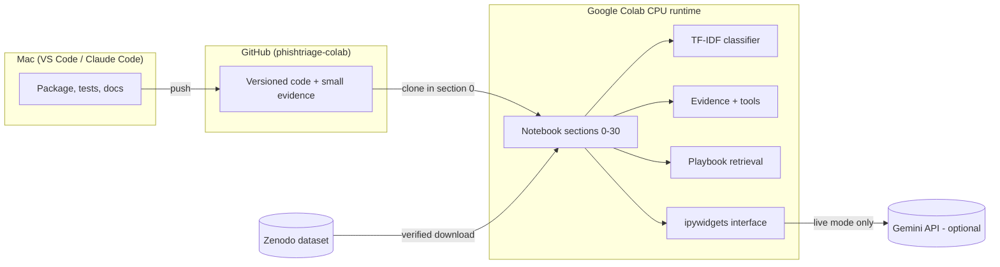
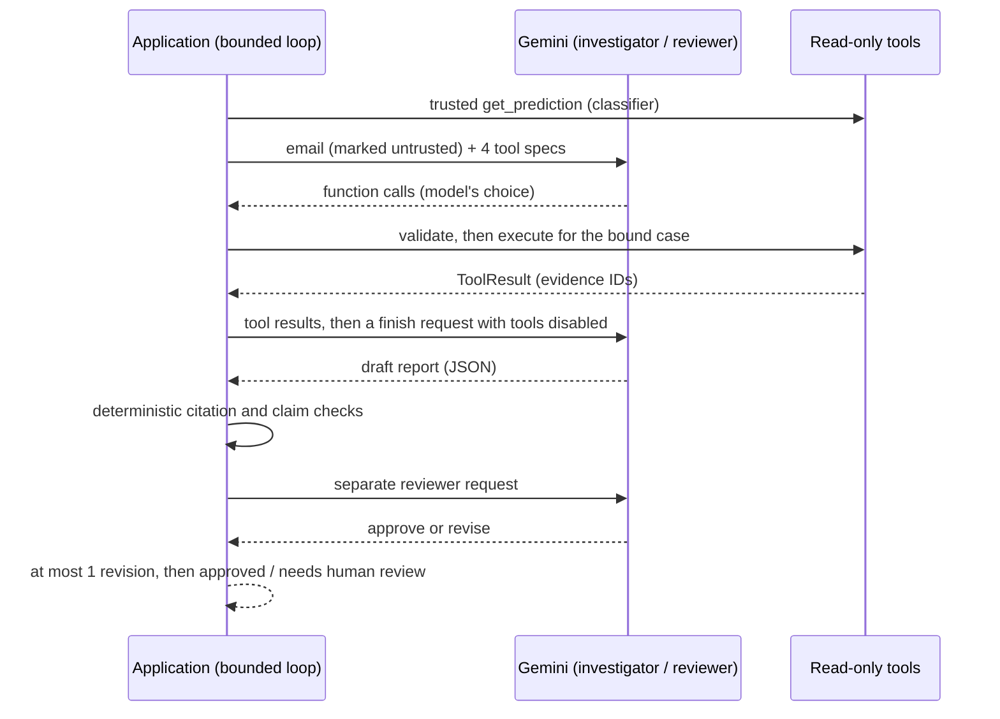

# PhishTriage

**Assigned title:** *Agentic AI-Based Phishing Email Detection and Explanation System*

PhishTriage helps a person decide what to do with a suspicious email. It combines a text classifier, safe
offline evidence extraction, retrieval of example response playbooks, and a bounded investigator–reviewer agent
workflow, and returns a cited, human-readable triage report.

> **Branch note:** the working project lives on the **`phishtriage-colab`** branch. `main` still holds only the
> initial scaffold.

**Problem and intended user.** People receive emails that may be phishing and must decide whether to trust,
verify or escalate them. PhishTriage is **decision support for human email triage**, for example a student,
help-desk analyst or security trainee. It explains which evidence was found, what is unknown, and what a human
should check next. It does **not** block, delete or reply to email, and it does not connect to a mailbox.

**Status (2026-10-16).** Every planned component is implemented and tested offline. The notebook has run end to
end locally at the current code, and in Google Colab at an earlier revision. Live Gemini behaviour is supported by
user-reported results only, and widget interaction in Colab has not yet been confirmed with evidence. See
[Testing and verification](#12-testing-and-verification) and [docs/VERIFICATION.md](docs/VERIFICATION.md).

## Contents
1. [Working features](#2-working-features)
2. [Quick start (API-free)](#3-quick-start-api-free)
3. [Live setup (optional)](#4-live-setup-optional)
4. [Architecture](#5-architecture)
5. [Components](#6-components-and-responsibilities)
6. [Algorithms and design choices](#7-algorithms-and-design-choices)
7. [Where agentic AI and RAG appear](#8-where-agentic-ai-and-rag-appear)
8. [Dataset and evaluation](#9-dataset-and-evaluation)
9. [Reading a report](#10-evidence-and-report-interpretation)
10. [Reliability, privacy and limits](#11-reliability-privacy-and-limits)
11. [Testing and verification](#12-testing-and-verification)
12. [Repository structure](#13-repository-structure)
13. [Troubleshooting](#14-troubleshooting)
14. [Limitations and future work](#15-limitations-and-future-work)
15. [References and attribution](#16-references-and-attribution)

Deeper reading: [docs/PROJECT_EXPLAINED.md](docs/PROJECT_EXPLAINED.md) (start here) ·
[docs/ARCHITECTURE.md](docs/ARCHITECTURE.md) · [docs/DEMO_RUNBOOK.md](docs/DEMO_RUNBOOK.md) ·
[docs/PRESENTATION_GUIDE.md](docs/PRESENTATION_GUIDE.md) · [docs/VIVA_QUESTIONS.md](docs/VIVA_QUESTIONS.md)

## 2. Working features
| API-free (always available) | Optional live (needs your Gemini key) |
|---|---|
| Verified dataset download (pinned SHA-256), audit and leakage-resistant grouped splits | Preflight check of the configured Gemini model (section 21) |
| Two TF-IDF baselines (logistic regression and Naive Bayes) with dev-only selection and a single held-out test run | Investigator agent that **chooses its own tool calls** within budgets (section 26 or the interface) |
| Safe parsing of pasted text or `.eml` files into typed evidence (no URL fetching, no HTML rendering, attachments never opened) | Separate reviewer pass with at most one revision |
| Eight original *example* playbooks and local TF-IDF retrieval | Bounded retries; quota stops a batch |
| Four read-only, case-bound tools | |
| Evidence-only reports (no LLM) and **scripted replay** of the agent workflow (labelled NOT live) | |
| ipywidgets interface (section 28) with escaped rendering, stale-input guard and JSON export | |

## 3. Quick start (API-free)
**Open in Colab (development branch):**
https://colab.research.google.com/github/nishtrip14/PhishTriage/blob/phishtriage-colab/notebooks/PhishTriage_Colab.ipynb

1. **Fresh CPU runtime:** *Runtime → Disconnect and delete runtime*, then *Runtime → Change runtime type → CPU*.
2. **Optional, pin the code:** in the section 0 code cell, set `PHISHTRIAGE_REVISION = "<full 40-character SHA>"`.
   The default value `"phishtriage-colab"` follows the branch, which moves with every push.
3. **Run:** *Runtime → Run all*. This takes a few minutes on CPU.
   * Section 0 clones the repository into `/content/PhishTriage` and prints the commit actually used.
   * Section 2 downloads about 23 MB from Zenodo.
   * *Run all* **never waits for input and never calls an LLM API**: the live flags are `False`.
4. **Interface:** it appears in **section 28**. Choose *Synthetic example → "SYNTHETIC: Benign notification"*, keep
   *Mode: Evidence only*, and click **Analyze**. Then try *Scripted replay* on the same example: the report shows
   the classifier saying *phishing* while the replayed agent says *no_strong_indicators*, with a disagreement
   warning.
5. **Export:** click **Export JSON**. The default *summary* omits the email text; tick *Detailed export* only if you
   need model-written text. Files go to `/content/phishtriage/exports/` and are downloaded.

There's nothing to install manually: section 0 installs any missing packages, and Colab ships most of them.
Local development (not needed for the demo): see [CLAUDE.md](CLAUDE.md) for the verified commands.

## 4. Live setup (optional)
1. **Key:** create a Gemini API key in Google AI Studio. In Colab, open the key icon (*Secrets*), add
   `GEMINI_API_KEY` and switch on **Notebook access**. Never paste the key into a cell or a chat.
2. **Model:** the single setting is `MODEL_OVERRIDE` in the **section 21** code cell. `None` means
   `$PHISHTRIAGE_GEMINI_MODEL` if set, otherwise **`gemini-3.6-flash`**.
3. **Preflight:** set `RUN_LLM_PREFLIGHT = True` in section 21 and run that cell. Expect `"status": "ok"`.
4. **One live case:** in **section 26**, set `RUN_LIVE_AGENT = True`. The default case is
   `LIVE_CASE = "credential_link"`. `RUN_ALL_LIVE_CASES = True` runs all four synthetic cases (at most 24 requests)
   and stops the batch on quota.
5. **Live in the interface:** in section 28, choose *Mode: Live agent*, tick the acknowledgement (content is sent to
   the provider), and Analyze a **synthetic** example.
6. **Changing the model:** set `MODEL_OVERRIDE` and re-run section 21. The new model has **no approval** until its
   own preflight passes; a changed google-genai version also invalidates approval. You don't need to re-run section
   28: it reads the current settings.
7. **Afterwards:** set the flags back to `False` before saving the notebook to GitHub.

**What a successful preflight establishes:** the key works, the model ID exists for your account, and one tiny
synthetic request returned the expected function call. **What it does not establish:** that full cases will
complete, that quota will last, or that the model's explanations will be correct.

**If the provider fails:**
* *Evidence only* and *Scripted replay* still work. Label them as such when you present.
* `provider_quota` stops the batch.
* `provider_server` (5xx) was retried within the budgets.

Details: [Troubleshooting](#14-troubleshooting).

## 5. Architecture


Everything runs in the Colab runtime **except** live language-model inference, which runs at Google's Gemini API.
In live mode, the email text and tool results are sent there.

**Training and evaluation flow** (sections 1–15): dataset → audit → grouped split → preprocessing → TF-IDF →
classifier → dev selection → one held-out evaluation → runtime artifact (`model.joblib` + manifest).

**Inference flow** (sections 16–28): pasted email or `.eml` → safe parsing → typed evidence → tools (classifier,
inspection, playbook retrieval) → investigator → deterministic validation → reviewer → at most one revision →
report and export.



More: [docs/ARCHITECTURE.md](docs/ARCHITECTURE.md).

## 6. Components and responsibilities
| Module (`phishtriage/`) | Responsibility | Main input | Main output |
|---|---|---|---|
| `data.py` | Verified download, validation, normalization, duplicate audit, grouped split | Zenodo CSVs | Normalized dataframe, audit, split manifest |
| `text.py` | Length policy, artifact normalization, `TextPreprocessor` | Text | Prepared text |
| `models.py` | Pipelines, `tune_on_dev`, `evaluate`, `top_terms` | Train/dev/test texts | Frozen configs, metrics |
| `inference.py` | `save_artifact` / `load_artifact` (SHA-256 checked), `predict` | Pipeline, manifest, email | Prediction dict |
| `email_input.py` | `from_pasted`, `parse_eml` (bounded, HTML → text) | Text or `.eml` bytes | `CaseInput` |
| `evidence.py` | `observe`, `CaseStore` | `CaseInput` | `EvidenceItem`s |
| `retrieval.py` | `PlaybookIndex` (separate TF-IDF), `run_retrieval_checks` | Query | `RetrievalHit`s or no match |
| `tools.py` | `TriageTools`: `get_prediction`, `inspect_email`, `retrieve_playbook`, `get_evidence` | Tool call | `ToolResult` |
| `agent_model.py` | `GeminiAdapter`, `ScriptedAdapter`, error classification | Model request | Model turn / `ProviderError` |
| `agent.py` | `run_triage`, `run_batch_triage`, validation, review, `make_live_adapter` | Case ID, mode | `TriageReport` + trace |
| `agent_replays.py` | Four SYNTHETIC demo emails and scripted turns | Case name | Replay adapter |
| `llm_preflight.py` | `LLMSettings`, `PreflightRegistry`, `preflight` | Model setting | Approval status |
| `ui.py` | `TriageSession`, `render_attempt_html`, `build_interface` | Widget input | Attempt, escaped HTML |
| `export.py` | `report_export`, `verification_record`, `live_outcome_counts` | Report | JSON-ready dict |

## 7. Algorithms and design choices
* **TF-IDF features.** Word 1–2-grams, `min_df=2`, `max_df=0.95`, at most 50,000 features, sublinear term
  frequency, and sparse float32 matrices. It is fast on a CPU, transparent (influential terms can be listed), and a
  standard baseline for text.
* **Logistic regression vs multinomial Naive Bayes.** These are two classic, cheap linear models with different
  assumptions: a discriminative model with `class_weight="balanced"` versus a generative model with smoothing α.
  Comparing them checks that conclusions don't depend on one model family.
* **Preprocessing.**
  * The first 20,000 characters are scored, and longer inputs are flagged `truncated`.
  * The *artifact-normalized* variant removes known collection cues, identically for both classes: mailing-list
    footers, list tags, emails, URLs, domains, collector names and years.
* **Selection and thresholds.**
  * Every learned transform is fitted on **train only**.
  * Hyperparameters are chosen by dev average precision, and the decision threshold by the maximum phishing F1 on
    dev.
  * The configurations were frozen and hashed **before** one test evaluation. The primary model, logistic
    regression on normalized text, was declared before testing.
* **Score meaning.** `predict_proba` gives a `model_estimated_probability_uncalibrated` value. It is **not**
  calibrated, and it is not a real-world probability of phishing.
* **Playbook retrieval.** A *separate* TF-IDF index over 40 playbook sections ranks them by cosine similarity, with
  a 0.10 minimum. The score measures **text relevance to the query**, not how likely an email is to be phishing.
* **Two roles.** The investigator gathers evidence and drafts; the reviewer checks support, contradictions,
  overconfidence and injected instructions. Splitting the roles gives a second, differently instructed pass, but it
  uses the **same provider and model**, so it is **not** an independent judge.
* **Direct, bounded SDK orchestration.** The official `google-genai` SDK is used without an agent framework, which
  keeps budgets, retries and validation explicit and testable. CrewAI was evaluated and rejected because its Gemini
  extra pinned an incompatible SDK and pulled in about 141 packages. What makes the workflow agentic is that the
  model chooses actions and the result feeds back into its decisions, not the use of a particular framework.

## 8. Where agentic AI and RAG appear
| Behaviour | Where | Who decides |
|---|---|---|
| Tool selection (which of 4 tools, with what arguments) | `run_triage` investigate rounds | **The model** (live mode) |
| Tool permissions, argument validation, case scope, budgets | `_Run.execute`, `AgentConfig` | **The application** |
| Evidence gathering | `inspect_email`, `get_evidence`, `get_prediction` | Model requests, application executes |
| Retrieval-augmented generation | `retrieve_playbook` hits are given to the investigator; retrieved versions are checked and passed to the reviewer | Model queries; the application validates citations |
| Reflection | Reviewer verdict → at most 1 revision | Model reviewer plus deterministic checks |
| Termination | No further calls, round/tool/request/deadline limits, approval or unresolved review | Application |

Keep these apart: **classifier inference** (scikit-learn, always local), the **deterministic tool pipeline**
(section 20, a fixed script), **scripted replay** (sections 24 and 28: pre-written model turns, *not* live), and
**live agent behaviour** (sections 26 and 28 in Live mode, Gemini at the provider).

## 9. Dataset and evaluation
* **Source:** *Phishing Email Curated Datasets* (Champa), Zenodo
  [10.5281/zenodo.8339691](https://doi.org/10.5281/zenodo.8339691), CC-BY-4.0.
* **Labels:** `Nazario.csv` → **phishing**; `SpamAssasin.csv` ham → **legitimate**. SpamAssassin spam is
  **excluded** (spam is not phishing).
* **Rejected candidate:** MeAJOR v2.0, whose data file contained only TREC spam/ham sources.

| Step | Records |
|---|---|
| Loaded | 7,374 |
| Excluded: spam / exact-duplicate extra copies | 1,718 / 14 |
| Included | 5,642 (4,090 legitimate, 1,552 phishing) |
| Near-duplicate groups (Jaccard ≥ 0.8 on word 5-gram shingles) | 141 groups covering 330 records; groups never cross splits |
| Train / dev / test | 3,949 / 846 / 847 (test: 614 legitimate, 233 phishing) |

**Held-out test results, run A** (canonical; local Mac, scikit-learn 1.9.1, code `e19b8cc`, reproduced exactly
at later commits):

| Model | Threshold | Precision | Recall | F1 (phishing) | FPR | AP | FP / FN |
|---|---|---|---|---|---|---|---|
| LR, original text | 0.550 | 1.000 | 0.983 | 0.991 | 0.000 | 0.9995 | 0 / 4 |
| NB, original text | 0.409 | 0.987 | 0.991 | 0.989 | 0.005 | 0.9973 | 3 / 2 |
| **LR, normalized (primary)** | 0.261 | 0.983 | 1.000 | 0.991 | 0.007 | 0.9998 | 4 / 0 |
| NB, normalized | 0.929 | 1.000 | 0.957 | 0.978 | 0.000 | 0.9999 | 0 / 10 |

**Run B** (Google Colab, scikit-learn 1.6.1, code `9acefcb`) used identical data and splits, and selected the same
hyperparameters. It learned slightly different thresholds and error counts; for example, the primary model had
threshold 0.2547 and the same 4 / 0 errors. The cause is not established. Both runs are in
[docs/MODEL_EVALUATION.md](docs/MODEL_EVALUATION.md).

> **Why these scores do not show real-world detection.** Every phishing email comes from one corpus (2015–2022)
> and every legitimate email from another (about 2002). This **source/class confound** means the high scores
> **cannot be attributed to generalizable phishing detection**: the models may exploit collection differences.
> Removing the known artifacts barely changed the scores, and residual cues remain. **There is no external
> validation set.** Re-running the evaluation reproduces it; it is not new validation. The four demo emails are
> **synthetic workflow tests**, not accuracy evidence. Notably, the classifier labels the synthetic benign
> notification *phishing* (≈ 0.90).

## 10. Evidence and report interpretation
| Evidence status | Meaning |
|---|---|
| `observed` | Present in the input (read by a local check) |
| `observed_absent` | Checked and **not found within a stated scope**; for example, no attachment parts in a supplied `.eml` |
| `unavailable` | Not provided (for example, pasted text has no headers or attachments), so **unknown** |
| `unverified_claim` | Asserted but unverifiable; for example, `Authentication-Results` headers |
| `error` | The check failed |

| Report field | How to read it |
|---|---|
| Classifier | Label and uncalibrated score from the frozen model. **The agent cannot change it.** |
| Agent assessment | `suspicious`, `no_strong_indicators` (**not** "safe": strong indicators may still exist outside the available evidence) or `insufficient_evidence` |
| Disagreement warning | The classifier label and the agent assessment differ. Both are shown for a human to weigh. |
| Reviewer approved | A second pass and the deterministic checks found no blocking problem. It is **not** a guarantee of correctness. |
| `needs_human_review` | The review was unresolved, or the budget or deadline ran out (a partial result) |
| `failed` | Provider or input failure with no usable draft. Nothing is invented. |
| Skipped (batch) | Not submitted because an earlier case hit quota, authentication or an unavailable model |
| Playbooks | Labelled **EXAMPLE POLICY**: teaching material, not an institutional policy or proof |

## 11. Reliability, privacy and limits
* **Budgets:** 3 tool rounds, 5 tool executions, 6 model requests, a 90 s deadline and 30 s per-request timeouts.
  * Two requests and 20 s are reserved for finalize and review.
  * There are at most 2 provider retries per run, using jittered backoff for timeout, network and 5xx errors.
  * A provider-requested delay is waited **in full** only if it fits the remaining budget.
  * Daily or unclassified quota is not retried.
* **Safety:** email and tool content is marked untrusted, the tools are read-only and bound to one case, unknown
  tools and arguments are rejected, and everything displayed is escaped.
* **Grounding checks:** citations must exist, belong to the case and have been retrieved in this run. Absence
  claims ("no attachments") must cite `observed_absent` evidence.
* **What the checks cannot do:** they are pattern-based. They **do not guarantee** semantic correctness or
  immunity to prompt injection.
* **Privacy:**
  * In live mode, the email subject/body and tool results are sent to the Gemini API.
  * Submitted cases stay in session memory, and nothing is written to Git.
  * The summary export omits the email text, case IDs and model free text. The detailed export is opt-in.

## 12. Testing and verification
| Layer | Evidence | Result |
|---|---|---|
| Offline tests | `python -m pytest -q tests` (fake providers, fake clocks, network blocked in the provider/agent tests) | **122 passed** with google-genai 2.31.0 (local, 2026-10-16); with 2.12.1: 121 passed, 1 skipped (ipywidgets absent there) |
| Local notebook | Sections 0–30, live flags off, at the current code | No errors; frozen evaluation reproduced |
| Colab notebook | Executed notebook at code `9acefcb` (sections 0–27, offline paths) | No errors; same data and split |
| Colab run of the current code | Owner reports a successful *Run all*. **The executed notebook has not been supplied** | Pending evidence |
| Widget interaction | Requires a person (`WIDGETS_CONFIRMED_BY_PERSON` in section 30) | Unverified |
| Provider preflight | User-reported `ok` (`gemini-3.6-flash`, SDK 2.12.1) at an unrecorded revision | User-reported only |
| Live cases | User-reported, older code: 1 approved, 1 `provider_server`, 2 `provider_quota` | User-reported only; the current retry/quota code has not been run live |

The full matrix and provenance are in [docs/VERIFICATION.md](docs/VERIFICATION.md).

## 13. Repository structure
```
notebooks/PhishTriage_Colab.ipynb   canonical notebook, sections 0–30 (outputs cleared, live flags False)
phishtriage/                        package (see section 6); playbooks/ holds the example playbooks and retrieval checks
tests/                              offline test suite
reports/                            small, text-free evidence (metrics, manifests, verification records)
docs/                               explanations, architecture, runbook, presentation and viva preparation
COLAB_STATUS.md                     status log by revision
CLAUDE.md                           development rules and verified commands
colab_import/                       (git-ignored) raw executed notebooks awaiting sanitization
```

## 14. Troubleshooting
| Symptom | Likely cause | Action |
|---|---|---|
| Preflight `missing_credentials` | No `GEMINI_API_KEY` secret, or notebook access is off | Add the secret, switch on *Notebook access*, re-run section 21 |
| `preflight_not_passed` / "no preflight for this model" | Preflight not run, model changed, or SDK changed | Re-run section 21 with `RUN_LLM_PREFLIGHT = True` for the configured model |
| `model_unavailable` | Model ID unknown to your account | Set `MODEL_OVERRIDE` to a listed model and run its preflight |
| `provider_server` (503) | Provider overloaded; retried within the budgets | Try later, use evidence-only or replay, or choose another model explicitly |
| `provider_quota` (429) | Rate or daily quota; daily and unclassified quota are not retried | Check usage in AI Studio. Daily quota resets on the provider's schedule; waiting a minute may not help |
| Section 0: "local changes or untracked source files" | `/content/PhishTriage` was edited | Recover the edits with `docs/colab_recovery_cell.py`, or set `ALLOW_MODIFIED_CHECKOUT = True` to run them as-is |
| `ArtifactError` (preprocessing or scikit-learn version) | Model saved under different code or versions | Re-run sections 0–14 in this runtime to retrain |
| Missing package | Fresh runtime | Section 0 installs missing packages; section 21 installs google-genai when live mode is requested |
| No widgets in section 28 | Widgets not rendering | Re-run section 28. If still blank: *Runtime → Restart session*, then *Run all* |
| Export button disabled, "Input changed" | Input edited after the result | Click **Analyze** again |
| `needs_human_review` / `failed` | Unresolved review, budget, or a provider failure | Read the termination detail and trace; this is intended, honest behaviour |
| Files gone after reconnecting | The Colab runtime was reset | `/content` is temporary: download exports and executed notebooks before leaving |

## 15. Limitations and future work
**Current limitations:**
* Source-confounded data and no external validation.
* Uncalibrated scores.
* Pattern-based grounding checks.
* The reviewer uses the same model as the investigator.
* Synthetic-only demos.
* Live behaviour verified only through user reports.
* Text-only classifier: link targets were stripped from the training data.

**Future work (not implemented):**
* An independent, multi-source labelled evaluation set.
* Classifiers that generalize across sources (for example, domain-held-out training).
* Calibration on a separate partition.
* Human evaluation of explanation quality.
* A broader absence and claim checker.
* Any deployment work: authentication, mailbox integration, monitoring.

## 16. References and attribution
* A. I. Champa, M. F. Rabbi, M. F. Zibran, "Curated Datasets and Feature Analysis for Phishing Email Detection with
  Machine Learning", IEEE ICMI 2024. Dataset: [Zenodo 8339691](https://zenodo.org/records/8339691) (CC-BY-4.0).
  Underlying corpora: the Nazario phishing corpus and the SpamAssassin public corpus.
* Gemini API: [models](https://ai.google.dev/gemini-api/docs/models),
  [function calling](https://ai.google.dev/gemini-api/docs/generate-content/function-calling),
  [thought signatures](https://ai.google.dev/gemini-api/docs/generate-content/thought-signatures),
  [API errors](https://ai.google.dev/gemini-api/docs/api-errors),
  [rate limits](https://ai.google.dev/gemini-api/docs/rate-limits); SDK
  [google-genai](https://pypi.org/project/google-genai/).
* scikit-learn: [TfidfVectorizer](https://scikit-learn.org/stable/modules/generated/sklearn.feature_extraction.text.TfidfVectorizer.html),
  [LogisticRegression](https://scikit-learn.org/stable/modules/generated/sklearn.linear_model.LogisticRegression.html),
  [MultinomialNB](https://scikit-learn.org/stable/modules/generated/sklearn.naive_bayes.MultinomialNB.html);
  [ipywidgets](https://ipywidgets.readthedocs.io/en/stable/).
* **License:** the repository has **no license file**, so no license is granted for the project code. The dataset
  is CC-BY-4.0 and is downloaded at runtime, never redistributed.
