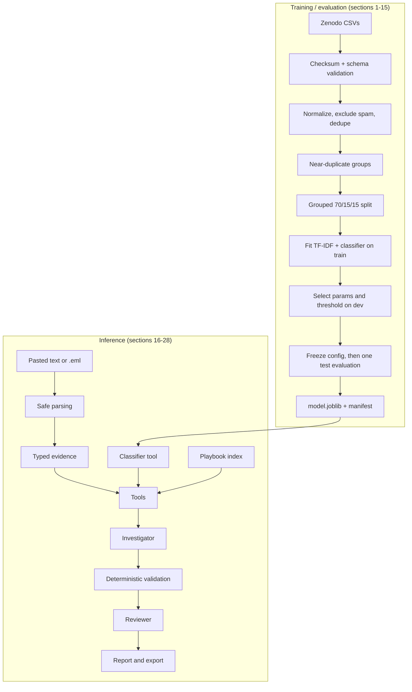
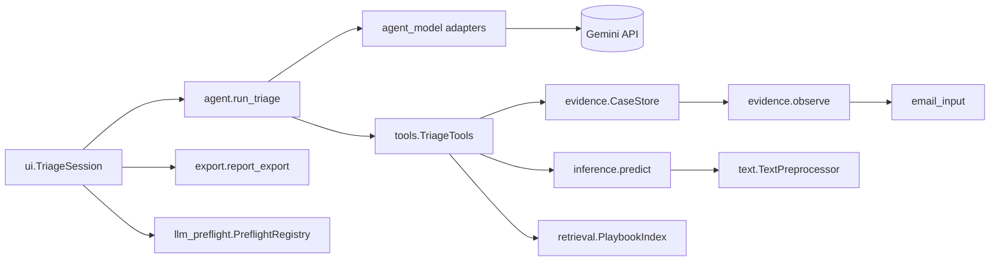
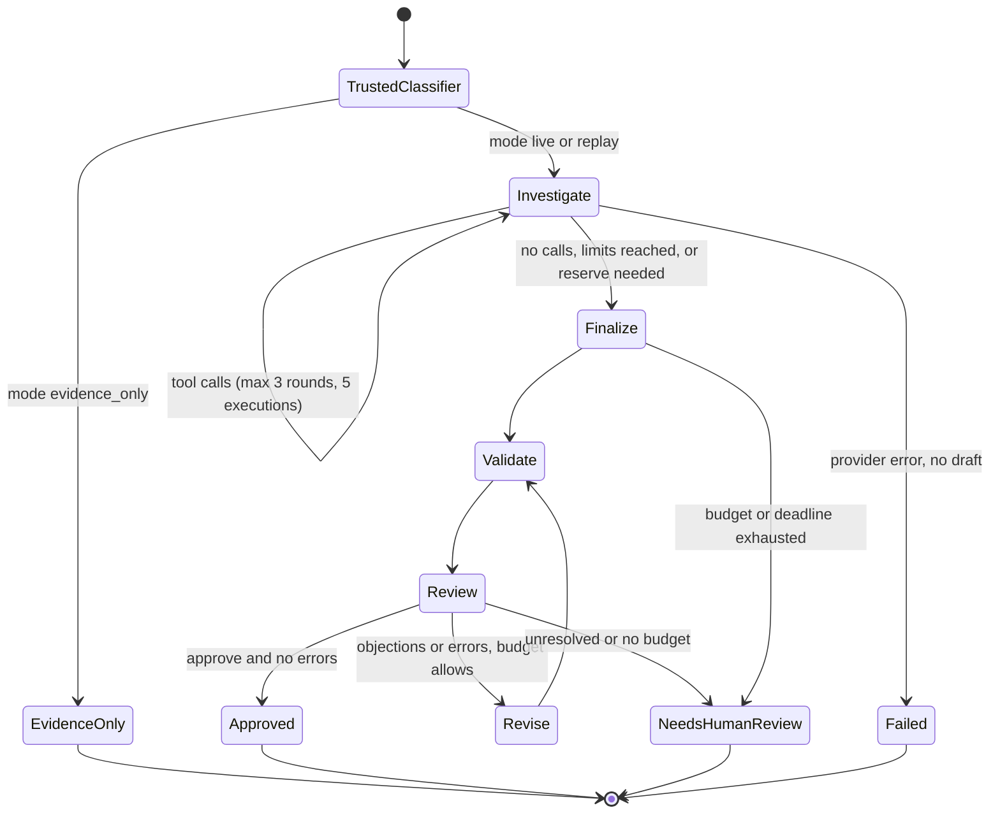
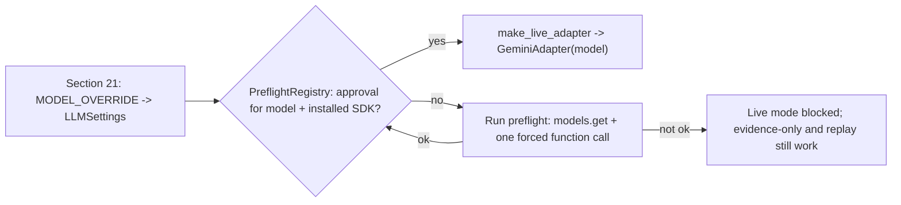

# Architecture

This is the authoritative design overview. Detailed agent rules are in [AGENT_WORKFLOW.md](AGENT_WORKFLOW.md),
evidence and tools in [TOOLS_AND_EVIDENCE.md](TOOLS_AND_EVIDENCE.md), and evaluation in
[MODEL_EVALUATION.md](MODEL_EVALUATION.md).

## 1. System boundaries
| Place | What runs or lives there |
|---|---|
| Mac (VS Code, Claude Code) | Development, offline tests, local notebook runs |
| GitHub `phishtriage-colab` | Versioned code, docs, small text-free evidence (`reports/`) |
| Google Colab CPU runtime | Notebook execution: data, training, evidence, retrieval, tools, the agent loop, the interface. Temporary storage in `/content` |
| Zenodo | Dataset source (downloaded at runtime and checksum-verified) |
| Google Gemini API (optional) | Language-model inference for the investigator and reviewer in live mode, **at the provider** |

Nothing touches a mailbox, sends email, fetches email links or executes attachments.

## 2. Training versus inference

## 3. Component relationships

## 4. Agent state transitions (`agent.run_triage`)

* **Request reservation:** an investigation request (or its retry) is sent only if 2 model requests remain for
  finalize and review afterwards. Finalize and revise need 1 left for review.
* **Time reservation:** investigation stops when less than `finish_reserve_s + min_request_window_s` (20 s + 2 s)
  remains.
* **Blocked investigation retry:** if a retry during investigation does not fit, investigation ends and the case
  finishes with the evidence already gathered.

## 5. Data, evidence and report contracts
| Contract | Key fields | Defined in |
|---|---|---|
| `CaseInput` | `case_id`, `input_kind`, `subject`, `body`, `headers`, `attachments` (metadata), `html_links`, `parse_warnings`; **no label field** | `schemas.py` |
| `EvidenceItem` | `evidence_id` (`<case>/ev-NNN`), `case_id`, `evidence_type`, `source`, `status` ∈ {observed, observed_absent, unverified_claim, unavailable, error}, `value`, escaped `excerpt`, `limitations` | `schemas.py` |
| `ToolResult` | `tool`, `status` ∈ {ok, unavailable, error, rejected}, `data`, `error`, `evidence_ids`, `limitations`, `truncated_output` (output ≤ 12,000 chars) | `schemas.py` |
| `RetrievalHit` | `doc_id`, `version`, `section`, `excerpt`, `relevance`, `relevance_type="tfidf_cosine_retrieval_relevance"`, `source_ref` | `schemas.py` |
| Draft (model output) | `assessment`, `findings[{statement, evidence_ids}]`, `playbook_refs[{doc_id, version, reason}]`, `missing_information`, `recommended_actions` (no classifier fields) | `agent.DRAFT_SCHEMA` |
| `TriageReport` | trusted `classifier`, `assessment`, findings with validity flags, verified playbook refs, missing info, review state, usage counters, provider `{name, model, sdk_version, errors}`, `termination_reason/detail`, limitations | `agent.py` |
| Export | summary (structure only) or detailed (opt-in) | `export.report_export` |

## 6. Model configuration and preflight lifecycle

* There is one setting (`LLMSettings`), read by section 26, by the interface (through callables, at every use)
  and by the reports.
* Changing the model or the SDK version invalidates approval. An unchanged, approved configuration is reused with no
  new calls.

## 7. Failure paths and budget enforcement
| Failure | Handling |
|---|---|
| Timeout, network, 5xx | Jittered backoff (2 s base, 8 s cap) or the provider's delay **in full** if it fits; at most 2 retries per run |
| 429 classified as a rate limit | Retried like the above |
| 429 daily or unclassified | Not retried → `provider_quota`; `run_batch_triage` skips later cases |
| 401, 403, 404, 400 | Not retried → `provider_auth`, `provider_model_unavailable` or `provider_invalid_request` |
| Invalid tool name or arguments, cross-case ID, duplicate call, tool budget | Rejected `ToolResult`; not executed |
| Invalid draft or review JSON | One revision, then `needs_human_review` (or `failed` if no draft parses) |
| Request budget or deadline | `needs_human_review` with the reason (a partial result) |

## 8. Runtime storage and persistence
| Data | Where | Persists? |
|---|---|---|
| Raw dataset, trained models, audit texts, exports | `/content/phishtriage/` (Colab) or `~/.cache/phishtriage` (local) | Until the runtime resets; never in Git |
| Repository checkout | `/content/PhishTriage` | Until the runtime resets |
| Submitted cases and attempt history | Python memory (`CaseStore`, `TriageSession.attempts`) | Session only |
| Small evidence (metrics, manifests, verification records) | `reports/` in Git | Committed deliberately |
| Raw executed notebooks | `colab_import/` (git-ignored) | Local only, sanitized before any use |

## 9. Design trade-offs
| Choice | Benefit | Cost |
|---|---|---|
| TF-IDF + linear models | CPU-fast, inspectable terms, strong baseline | No deep semantics; may learn corpus style |
| Grouped splits | Prevents near-duplicate leakage | Does not remove the source/class confound |
| Direct SDK loop, no framework | Explicit budgets and tests; no dependency conflicts | More code to maintain |
| Same model as reviewer | Simple and cheap | Not an independent check |
| Deterministic, pattern-based checks | Catch invalid citations and common absence claims reliably | Cannot judge semantic truth |
| Evidence-only and replay fallbacks | The demo works without a key or quota | Must never be presented as live results |
